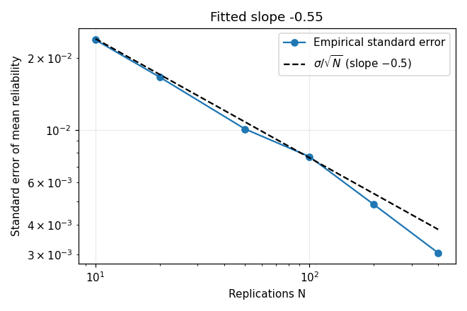

# Kilinochchi Rainwater Harvesting Simulator
A stochastic simulation explores how tank capacity, roof area, household demand and collection efficiency affect daily rainwater availability in Kilinochchi, Sri Lanka.

## Live demo and notebook

[Open the live simulator](https://ja390.github.io/kilinochchi-rainwater-harvesting-simulator/kilinochchi-rainwater-simulator/web%20demo/index.html)

[](https://colab.research.google.com/github/ja390/kilinochchi-rainwater-harvesting-simulator/blob/main/notebook/rainwater_simulator.ipynb)

![Simulator interface]:


## Problem and question

Rainfall varies through the year, and a household tank must carry water through dry periods. The main question is: **How does tank capacity affect the share of days when the household's full daily water demand can be met?** The simulation also varies roof area, demand and collection efficiency.

## Quick start

### Run the notebook

1. Open the notebook with the Colab badge above.
2. Choose **Runtime → Restart session and run all**.
3. Allow internet access for the NASA POWER rainfall request. The notebook installs its Python dependencies and writes CSV outputs and figures to `outputs/`.
4. Review every verification result and inspect the rainfall validation before using results. Download `outputs.zip` at the end if you need the generated files.

For local Jupyter use, install Python 3.10 or later and run:

```bash
python -m pip install -r requirements.txt
```

Then open `notebook/rainwater_simulator.ipynb` and run all cells with an internet connection.

### Open the web demo

The live demo runs in a current browser without a server or third-party JavaScript libraries. Set at least three household parameters, optionally load `kilinochchi_rainfall_calibration.csv` generated by the notebook, and select **Start**. Use **Pause**, **Reset** and **Run reference check** to explore the simulator.

## User guide

See [USER_GUIDE.md](USER_GUIDE.md) for parameter definitions, calibration-file instructions, controls and interpretation notes.

## Model and mathematics

The notebook uses daily precipitation (`PRECTOTCORR`) from NASA POWER for 9.38° N, 80.40° E, covering 2015–2024. Wet/dry occurrence is modelled with month-specific transition probabilities. Wet-day depth is a 1 mm threshold plus a gamma-distributed excess. Roof runoff is added to storage, overflow above capacity is spilled, then household demand is served. See [THEORY.md](THEORY.md) for equations, fitting details, simulation sequence and verification.

## Verification

The daily balance is checked against an independent implementation and physical bounds. The browser's deterministic reference check reproduces the notebook benchmark within `1e-9` for storage, fully supplied days, shortage, overflow and supplied volume. This verifies the fixed water-balance calculation; it does not imply that browser and NumPy random streams or annual reliability estimates match.



## Concepts applied

This project applies a month-dependent discrete-time Markov chain for wet/dry rainfall occurrence, method-of-moments fitting and random variate generation for shifted-gamma wet-day depths, discrete daily state updates with mass-balance checks, and Monte Carlo estimation with confidence intervals and empirical standard-error scaling.

## Results, limitations and future work

In the packaged 200-replication run, a 12 m³ tank for the baseline scenario (100 m² roof, 0.8 collection efficiency and 0.35 m³/day demand) had mean simulated reliability of 60.74% (95% confidence interval: 59.73%–61.76%). Reliability means the share of scored days on which full daily demand is met. Re-run the notebook to regenerate results before reporting them.

NASA POWER values are gridded estimates, not household rain-gauge measurements. The rainfall record spans ten years and the held-out validation period is two years. Roof area, efficiency and demand are scenario inputs. The model omits water quality, first-flush losses, leakage, evaporation, seasonal demand changes and costs. Future work could use local gauge data, longer validation records and measured household inputs. See `data/` and `figures/` for the packaged CSV results and plots; consult `data/README.md` for provenance.

## Key references

NASA POWER Daily API; Richardson (1981); Wilks (1998); and Law (2015). Full citations, DOIs and links are in [REFERENCES.md](REFERENCES.md).

## AI assistance

AI tools assisted with code drafting, debugging and document preparation. The project author reviewed the code, equations, outputs and cited sources. Detailed prompts and AI-use records are kept in a private project folder and are not part of this public repository.

## Licence and data credits

Code and project documentation are released under the MIT License; see [LICENSE](LICENSE). Rainfall data are sourced from the [NASA POWER Daily API](https://power.larc.nasa.gov/docs/services/api/temporal/daily/). See [data/README.md](data/README.md) for the generated-data inventory and source notes.
